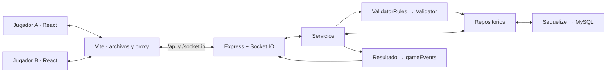

# Cuatro en Línea — Capstone de Redes 2

**Autor:** Marcelo Medrano Fonseca

Juego multijugador para dos usuarios, con interfaz React, API HTTP y comunicación en tiempo real mediante Socket.IO. El servidor valida las jugadas, calcula turnos y resultados, guarda el estado en MySQL y lo distribuye a los participantes.

## Funcionalidades actuales

- Registro y login con JWT; contraseñas protegidas mediante bcrypt y correo opcional en el backend.
- Menú para crear una partida o entrar por su ID con una invitación existente.
- Lobby con ID de partida, nombres e IDs de jugadores, creador y estado de invitación.
- Invitaciones por ID de usuario y notificación en tiempo real al destinatario conectado en el menú.
- Inicio manual por el creador cuando ambos jugadores han aceptado. Aceptar una invitación no inicia la partida.
- Tablero de 6 filas y 7 columnas dibujado con React y CSS, con fichas rojas y amarillas.
- Selección de columna al pulsar un círculo vacío, resaltado verde y colocación en la fila libre más baja.
- Turnos sincronizados, detección de cuatro en línea horizontal, vertical y diagonal, y empate por tablero lleno.
- Ventana de resultado con ganador o empate y regreso al menú de crear/unirse.
- Reconexión y recuperación del tablero guardado; restauración de la partida al recargar la misma pestaña mientras el JWT sea válido.
- API para consultar, administrar y abandonar partidas, además de estadísticas de solicitudes HTTP.

La interfaz actual no incluye pantallas de perfil, administración ni un botón de abandono. Esas operaciones se pueden utilizar mediante la API cuando corresponda. Los componentes de cartas y tablero de UNO ya fueron eliminados.

## Tecnologías y arquitectura

| Área | Tecnología |
| --- | --- |
| Backend | Node.js, Express 5, JavaScript |
| Tiempo real | Socket.IO 4 |
| Persistencia | MySQL, Sequelize 6, mysql2 |
| Autenticación | JWT, bcrypt |
| Frontend | React 18, Vite 5, CSS Modules |
| Pruebas | Jest, Supertest, cliente Socket.IO y SQLite en memoria |
| Registro de errores | Winston |



Este diagrama representa el entorno de desarrollo. React se ejecuta en los navegadores; Vite sirve sus archivos y actúa como proxy. Los jugadores se comunican con el servidor, no directamente entre sí.

Las dependencias se ensamblan en [src/container.js](src/container.js). Los controladores HTTP y manejadores de sockets llaman a los mismos servicios. Cada servicio utiliza sus reglas compuestas, estas ejecutan los validadores, y los repositorios realizan las operaciones de persistencia. Los errores de validación usan `Result.Err({ statusCode, message })`.

[gameEvents.js](src/Presentation/Sockets/gameEvents.js) publica los estados después de acciones exitosas, tanto HTTP como Socket.IO. Los dos jugadores reciben el tablero público completo; no existen manos privadas ni puntuaciones de cartas.

### Estructura

```text
src/
  Data Access/
    Models/                  # User, Game, GamePlayer, Invitation, History, ApiStats
    Repositories/            # Consultas a la base de datos
    connectFourSchema.js     # Forma y valores del tablero persistido
    database.js              # Configuración de Sequelize
  Logic/
    Monads/                  # Result.Ok / Result.Err
    Services/                # Autenticación, partidas y estadísticas
    Validators/              # Validaciones y su composición
  Presentation/
    Controllers/             # Adaptadores HTTP
    Routes/                  # Rutas de Express
    Sockets/                 # Eventos, salas y publicación de estados
  Middleware/                # Autenticación, errores y métricas
  Helpers/                   # Reglas de Cuatro en Línea y utilidades
  Tests/                     # Pruebas del backend
  app.js                     # Aplicación Express
  container.js               # Inyección de dependencias
  server.js                  # Arranque de HTTP, Socket.IO y base de datos
4Inline-frontend/
  src/
    api/                     # HTTP, sockets y recuperación de partidas
    hooks/                   # useGameConnection
    components/              # Login, registro, menú, lobby y tablero
    Tests/                   # Pruebas de conexión, movimientos y recuperación
    App.jsx                  # Navegación y partida activa
  vite.config.js             # Proxy de desarrollo
```

## Instalación y ejecución local

Se necesita Node.js 20 o superior, npm y una instancia MySQL accesible. La dependencia de desarrollo `cross-env` requiere Node.js >=20.

### Backend

Desde la raíz del repositorio:

```bash
npm install
```

Copia `.env.example` a `.env` y completa los valores. En PowerShell puedes usar `Copy-Item .env.example .env` si todavía no tienes un `.env`.

Ejemplo para usar el proxy del frontend sin modificarlo:

```env
HOST=127.0.0.1
PORT=3000
DB_HOST=127.0.0.1
DB_PORT=3306
DB_NAME=connect4_db
DB_USER=tu_usuario
DB_PASSWORD=tu_password
DB_DIALECT=mysql
JWT_SECRET=reemplaza_este_valor_por_un_secreto_largo_y_aleatorio
JWT_EXPIRES_IN=1h
```

**Alineación de puertos:** `.env.example` actualmente propone `PORT=3100`, pero los dos destinos de [vite.config.js](4Inline-frontend/vite.config.js) apuntan a `http://localhost:3000`. Usa `PORT=3000` en tu `.env`, o cambia ambos destinos del proxy al puerto elegido. Postman debe utilizar ese mismo puerto del backend.

Crea previamente la base de datos indicada por `DB_NAME`, por ejemplo:

```sql
CREATE DATABASE connect4_db;
```

Después ejecuta:

```bash
npm run dev
```

[server.js](src/server.js) autentica la conexión a MySQL y ejecuta `sequelize.sync({ alter: true })` antes de escuchar conexiones. Esto sincroniza las tablas y puede modificar su estructura; no crea la base de datos MySQL. El flujo actual no utiliza migraciones.

### Frontend

En otra terminal:

```bash
cd 4Inline-frontend
npm install
npm run dev
```

Abre la dirección que indique Vite, normalmente `http://localhost:5173`. Para simular dos usuarios, utiliza sesiones de navegador independientes, por ejemplo una ventana normal y una privada: las pestañas de un mismo perfil comparten el JWT guardado en `localStorage`.

### Puertos y conexiones

| Servicio | Configuración |
| --- | --- |
| Vite | 5173 por defecto; puede elegir otro si está ocupado. |
| API HTTP y Socket.IO | Comparten el mismo `http.Server`; `PORT` o 3000 como respaldo. |
| Dirección del backend | `HOST` o `127.0.0.1` como respaldo. |
| MySQL | `DB_HOST` y `DB_PORT`; 3306 si no se especifica puerto. |

Vite redirige `/api` y `/socket.io` al backend. El cliente usa `fetch('/api/...')` e `io('/')`. Socket.IO puede comenzar con HTTP long-polling e intentar pasar a WebSocket. El backend mantiene una conexión independiente con MySQL.

Si MySQL está en Docker con un mapeo `3307:3306`, un backend ejecutado en el computador se conecta al puerto publicado `3307`. El puerto `3306` corresponde al interior del contenedor. Si ambos servicios están en la misma red de Docker, se utiliza normalmente el nombre del servicio MySQL y su puerto interno. Este repositorio no incluye actualmente Dockerfile ni Compose.

`127.0.0.1` solo permite acceso local directo al backend. El despliegue en otra máquina o en una red requiere configurar las direcciones, el proxy y el firewall según esa topología.

## Cómo jugar

1. Registra dos usuarios e inicia sesión en cada navegador.
2. El jugador A pulsa **Crear partida**. Se crea una partida `pending`, A queda aceptado como creador y se muestra el ID en el lobby.
3. A introduce el ID de usuario de B y pulsa **Invitar**. La invitación utiliza esa misma partida.
4. B recibe una notificación si está conectado y en el menú. Pulsa **Unirse a partida** con el ID de la partida para aceptar. También puede introducir manualmente el ID si no recibió la notificación.
5. Con ambos aceptados, el botón de inicio del creador se habilita en verde. A pulsa **Empezar partida**; ambos pasan al tablero y A juega primero.
6. En cada turno, pulsa un círculo vacío de la columna deseada. El servidor determina dónde cae la ficha y envía el tablero actualizado a ambos jugadores.
7. Al ganar o empatar aparece el resultado y un botón para volver al menú.

Un usuario que participa como aceptado o invitado en una partida pendiente o activa no puede crear otra. El creador solo puede invitar si queda libre el lugar del rival. Rechazar una invitación libera ese lugar y conserva la partida pendiente; el modelo no permite volver a invitar al mismo destinatario en esa misma partida, pero sí a otro usuario disponible.

## Autenticación

`POST /api/auth/login` recibe `username` y `password` y devuelve `{ "accessToken": "..." }`.

Las solicitudes HTTP protegidas aceptan el JWT en el cuerpo JSON:

```json
{
  "access_token": "TU_JWT",
  "game_id": 42
}
```

También admiten `Authorization: Bearer TU_JWT`. El backend obtiene la identidad del token; no debes enviar un `userId` para actuar como otro jugador.

Socket.IO envía el token como `auth.token`. Se valida al establecer la conexión y nuevamente al manejar comandos. Un token vencido o revocado no se renueva mediante la reconexión.

## API HTTP

Base local del ejemplo: `http://localhost:3000/api`. Ajusta el puerto si cambiaste `PORT`. Envía los cuerpos como JSON con `Content-Type: application/json`.

### Usuarios — `/api/auth`

| Método | Ruta | Cuerpo / comportamiento |
| --- | --- | --- |
| POST | `/register` | `username`, `password`, `email` opcional. |
| POST | `/login` | `username`, `password`; devuelve `accessToken`. |
| POST | `/logout` | JWT; revoca el token actual. |
| POST | `/profile` | JWT; devuelve `id` y `username`. Sirve para conocer el ID a invitar. |
| DELETE | `/users/:id` | JWT; eliminación de la propia cuenta, respuesta exitosa 204 sin cuerpo. |

### Partidas — `/api/games`

Todas estas rutas requieren JWT. Las consultas y operaciones administrativas actuales utilizan **POST**, conforme a los routers existentes.

| Método | Ruta | Campos adicionales al JWT | Comportamiento |
| --- | --- | --- | --- |
| POST | `/` | Ninguno | Crear partida; respuesta 201 con `message` y `game_id`. |
| POST | `/all` | Ninguno | Listar partidas. |
| POST | `/by-id` | `game_id` | Consultar estado público. |
| POST | `/delete` | `game_id` | Eliminar; solo el creador. |
| POST | `/update` | `game_id`, `updates` | Administración manual; solo el creador. |
| POST | `/invitations` | `game_id`, `opponent_id` | Invitar a una partida pendiente existente; solo el creador. |
| POST | `/invitations/respond` | `game_id`, `accept` booleano | Aceptar o rechazar la invitación propia. |
| POST | `/start` | `game_id` | Iniciar; creador y dos jugadores aceptados. |
| POST | `/make-move` | `game_id`, `column` entero 0–6 | Jugar en una partida activa y en el turno propio. |
| POST | `/leave` | `game_id` | Abandonar una partida activa; gana el rival con `finishReason: abandoned`. |

`updates` permite `board`, `state`, `currentPlayerId`, `winnerId` y `finishReason`, sujetos a validación de coherencia. No existe un rol de administrador separado: el permiso se basa en ser creador.

`/all` y `/by-id` requieren autenticación, pero no pertenencia a la partida. En cambio, el evento `game:join` sí valida la pertenencia antes de suscribir la conexión a la sala.

Los errores HTTP tienen forma `{ "error": "mensaje" }`. Los errores previstos distinguen entradas inválidas (400), autenticación (401), permisos (403), recursos inexistentes (404) y conflictos de estado (409).

### Ejemplo de partida en Postman

Después de obtener los JWT de A y B, ejecuta estas solicitudes en orden. Sustituye 42 por el ID devuelto al crear y 2 por el ID real de B.

| Paso | URL relativa a `/api/games` | Cuerpo JSON |
| --- | --- | --- |
| Crear, como A | POST `/` | `{"access_token":"JWT_A"}` |
| Invitar, como A | POST `/invitations` | `{"access_token":"JWT_A","game_id":42,"opponent_id":2}` |
| Aceptar, como B | POST `/invitations/respond` | `{"access_token":"JWT_B","game_id":42,"accept":true}` |
| Iniciar, como A | POST `/start` | `{"access_token":"JWT_A","game_id":42}` |
| Jugar, como A | POST `/make-move` | `{"access_token":"JWT_A","game_id":42,"column":0}` |
| Jugar, como B | POST `/make-move` | `{"access_token":"JWT_B","game_id":42,"column":1}` |

Para comprobar una victoria vertical, alterna las columnas `0, 1, 0, 1, 0, 1, 0`, empezando por A. La última respuesta contiene `state: finished`, `winnerId`, `finishReason: four_in_line`, `message` y `winner: { userId, username, piece }`.

Aceptar no basta para jugar: debes enviar `/start`. No hay una ruta HTTP `/join`; en Postman la aceptación se realiza con `/invitations/respond`.

### Estadísticas — `/api/stats`

Rutas GET: `/requests`, `/response-times`, `/status-codes` y `/popular-endpoints`. Registran/consultan métricas HTTP; no son estadísticas de jugadas ni mediciones de todos los eventos Socket.IO. Actualmente estas rutas no tienen middleware JWT.

## Eventos Socket.IO

El frontend usa HTTP para registro, login y creación; utiliza Socket.IO para invitar, aceptar, entrar a la sala, iniciar y jugar. Las versiones HTTP y socket comparten servicios.

### Cliente → servidor

| Evento | Datos |
| --- | --- |
| `game:create` | `{}` |
| `game:list` | `{}` |
| `game:get` | `{ game_id }` |
| `game:join` | `{ game_id }`; consulta estado y suscribe a un participante existente. |
| `game:invite` | `{ game_id, opponent_id }` |
| `game:invitation:respond` | `{ game_id, accept }` |
| `game:start` | `{ game_id }` |
| `game:move` | `{ game_id, column }` |
| `game:leave` | `{ game_id }` |
| `game:update` | `{ game_id, updates }` |
| `game:delete` | `{ game_id }` |

`game:join` por sí solo no crea participantes ni acepta invitaciones. El frontend consulta la participación, envía `game:invitation:respond` si está `invited`, y vuelve a solicitar el estado.

### Servidor → cliente

| Evento | Contenido / propósito |
| --- | --- |
| Mismo nombre del comando | Resultado directo al solicitante; no se usa un callback de acknowledgement en estos manejadores. |
| `game:state` | Estado completo y público de la partida. |
| `game:invitation` | `gameId`, `opponentId`, `creator: { id, username }`; notificación al destinatario. |
| `game:invitation:accepted` | Confirmación de aceptación con `gameId`, `status`, `message`. |
| `game:invitation:rejected` | Confirmación de rechazo con `gameId`, `status`, `message`. |
| `game:ended` | Estado final de una partida terminada. |
| `game:deleted` | `{ message, game_id }`. |
| `error` | `{ event, message }` para el cliente que envió el comando. |
| `connect_error` | Error observado por el cliente al fallar la conexión/autenticación. |

Las conexiones se agrupan en `user:<id>` para avisos a un usuario y `game-<id>` para actualizaciones de una partida. Las salas son agrupaciones de Socket.IO, no puertos adicionales. Al terminar o eliminar una partida se retiran las conexiones de su sala.

## Estado y persistencia

| Campo público | Significado |
| --- | --- |
| `gameId`, `creatorId` | Identificadores de partida y creador. |
| `state` | Flujo normal: `pending` → `in_progress` → `finished`. |
| `board` | Matriz 6×7: `0` vacío, `1` rojo, `2` amarillo. Fila 0 arriba; fila 5 abajo. |
| `currentPlayerId` | Jugador al que le toca; `null` fuera de una partida activa. |
| `winnerId`, `finishReason` | Resultado: `four_in_line`, `draw` o `abandoned`; empate sin ganador. |
| `createdAt`, `finishedAt` | Fechas de creación y finalización. |
| `players` | `userId`, `username`, `piece` (`R`/`Y`), `turnOrder`, `invitationStatus`. |

El modelo también admite el estado/reason `rejected` para administración, pero rechazar una invitación en el flujo normal mantiene la partida `pending` y libera al rival.

MySQL conserva usuarios, partidas, participantes, invitaciones, historial y métricas HTTP. La creación y respuesta de invitaciones utilizan transacciones existentes. Actualmente `makeMove` guarda partida e historial en operaciones separadas, sin una transacción que agrupe todas esas escrituras.

La respuesta de la jugada ganadora añade `message` y `winner`. Al recuperar una partida terminada, la interfaz también puede obtener el nombre del ganador a partir de `winnerId` y `players`.

## Desconexión y recuperación

[gameConnection.js](4Inline-frontend/src/api/gameConnection.js) y [useGameConnection.js](4Inline-frontend/src/hooks/useGameConnection.js) comparten la suscripción entre lobby y tablero:

1. Deshabilitan acciones mientras se recupera la conexión/estado.
2. Al conectar, solicitan `game:join` para recuperar el estado y volver a la sala si sigue activa o pendiente.
3. Escuchan `game:state`, `game:ended` y `game:deleted`, filtrando por ID de partida.
4. Limpian los listeners al salir de la pantalla e ignoran respuestas de solicitudes anteriores que ya no corresponden.

Los movimientos requieren conexión y se envían como eventos `volatile`, para no dejarlos en cola durante una caída. Los comandos tienen un tiempo de espera de 10 segundos. Si una jugada falla o no recibe respuesta, el frontend consulta el estado antes de permitir otro intento: la operación pudo haberse guardado aunque se perdiera su respuesta.

[activeGame.js](4Inline-frontend/src/api/activeGame.js) recuerda el ID por usuario en `sessionStorage`. Recargar la misma pestaña permite recuperar la partida, incluso su resultado si terminó durante la desconexión. No se reproducen todos los eventos perdidos; se solicita el estado guardado actual.

Desconectarse o volver al menú no ejecuta abandono. Volver al menú borra el recordatorio de la pestaña, pero una partida pendiente/activa sigue existiendo y se puede recuperar por ID. Las invitaciones offline permanecen en la base de datos, aunque la interfaz no tiene una bandeja ni reproduce automáticamente notificaciones perdidas.

## Pruebas y compilación

Desde la raíz, ejecutar Jest una sola vez:

```bash
npm test -- --watchAll=false --runInBand
```

`npm test` por sí solo inicia el modo continuo (`--watchAll`). Para cobertura:

```bash
npm run test:coverage
```

La configuración de Jest incluye archivos `**/Tests/**/*.test.js`, tanto del backend como del frontend. [TestSetup.js](src/Tests/TestSetup.js) sustituye la conexión MySQL por SQLite en memoria. Las pruebas incluyen reglas, servicios, controladores, repositorios, flujo HTTP y clientes Socket.IO. Las pruebas de frontend cubren recuperación, aislamiento del recordatorio por usuario y movimientos durante desconexiones; no equivalen a pruebas visuales del navegador.

Para ejecutar las pruebas enfocadas en la conexión del frontend:

```bash
npm test -- --watchAll=false --runInBand --runTestsByPath 4Inline-frontend/src/Tests/gameConnection.test.js 4Inline-frontend/src/Tests/activeGame.test.js 4Inline-frontend/src/Tests/moveSocket.test.js
```

Para compilar la interfaz:

```bash
cd 4Inline-frontend
npm run build
```

El resultado se genera en `4Inline-frontend/dist`. Los proxies descritos aquí pertenecen al servidor de desarrollo; un despliegue del build debe configurar cómo llegar a `/api` y `/socket.io`.

## Alcance y mejoras pendientes

- HTTP local sin TLS configurado en Node; un despliegue público requiere definir HTTPS/WSS y sus certificados o terminación TLS.
- Socket.IO tiene `cors.origin: '*'`; se deben definir los orígenes del despliegue.
- La revocación de JWT vive en memoria y se pierde al reiniciar el proceso. No hay renovación automática de tokens.
- El backend es una sola instancia. Varias instancias requerirían coordinación de eventos/salas y del estado compartido.
- El flujo de movimientos no tiene control transaccional completo ni identificadores de petición para deduplicar reintentos.
- El botón Start cuenta participantes aceptados; no comprueba que el rival tenga una conexión activa en ese instante.

Más detalles de la interfaz en [4Inline-frontend/README.md](4Inline-frontend/README.md).
